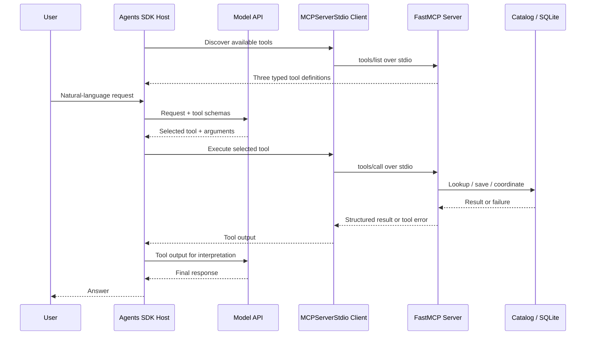

# Campus Reading MCP Toolkit

EECE 503P/798S — C5 Agent Tools assignment. A campus reading assistant built with
**FastMCP** and the **OpenAI Agents SDK**, exposing **exactly three MCP tools**.

Repository: [Jad490/C5-Agent-Tools](https://github.com/Jad490/C5-Agent-Tools).
The repository is private; give the grader access before submitting its link.

The catalog is a bundled demonstration dataset with real book titles and
illustrative shelf labels. It is not connected to a real campus library.
Saving a book writes a real, persistent local SQLite record.

## Quick start

If you are using the original local workspace, activate the configured `.venv`
with `source .venv/bin/activate`. For a fresh checkout, follow the steps below.

Python **3.12 or newer** is required. Run commands from this repository's root.
For the dependencies installed and verified for this submission, use the lock file:

```bash
python3.12 -m venv .venv
source .venv/bin/activate
python -m pip install -r requirements.lock
python -m pip install --no-deps -e .
```

On Windows, activate with `.venv\Scripts\activate` instead.

The assignment asks for latest FastMCP and Agents SDK releases. The locked versions
were the latest stable versions resolved during setup on November 1, 2026:
FastMCP **4.1.4** and `openai-agents` **0.24.0**. To deliberately refresh them later,
run `python -m pip install --upgrade -e '.[dev]'`, rerun verification, and regenerate
the lock with `python -m pip freeze --exclude-editable > requirements.lock`.

## Run without an API key

```bash
ruff check .
pytest -q
python -m scripts.smoke_mcp
```

The smoke script starts the real FastMCP subprocess and calls it through the
Agents SDK's `MCPServerStdio` client. It verifies all three tools, persistent saves,
and error replies in an isolated temporary directory. **It does not call a model
and does not replace the required live agent screencast.**

## Run the live agent

Create `.env` from `.env.example` if it does not exist. The agent automatically
loads `.env` from the project root; do not show it in a recording or commit it.

Default setup, using Gemini with the OpenAI Agents SDK:

```dotenv
MODEL_PROVIDER=gemini
GEMINI_API_KEY=your_key_here
GEMINI_MODEL=gemini-3.1-flash-lite
```

Use a Gemini API key with model access and available quota. No OpenAI API key is
needed for this mode. All four live demo scenarios passed with this model; see
[the live verification record](evidence/live-demo.md). Then:

```bash
python -m campus_mcp.agent
```

Example requests:

```text
Find books about agents. Show at most 2; do not save anything.
Save book B001 to my list eece503p.
Find 2 books about databases and save them to eece503p.
Try to save B999 to eece503p. Report the server error.
```

For a single request:

```bash
python -m campus_mcp.agent --prompt "Find books about agents without saving anything."
```

For the four-scenario live demo, use a new database filename so the first run shows
new writes. `--step` pauses before each request for narration:

```bash
python -m campus_mcp.agent --demo --step --db runtime/recording-01.sqlite3
python -m scripts.show_saved --db runtime/recording-01.sqlite3
```

The demo checks that the model actually selected the expected tool in every
scenario, including an error reply for B999. It fails if routing is missing or
incorrect. The model sees all three tools and selects among them; the host does
not force a per-prompt tool choice. Follow [the timed screencast guide](docs/screencast.md).

### SDK requirement and optional OpenAI provider

The PDF explicitly requires the **OpenAI Agents SDK**, which this project uses in
both modes. It does not specify a model provider. The submitted demonstration
uses Gemini as the model provider. If a separate class rule requires an OpenAI
model, select the optional OpenAI provider below.

For an OpenAI model, configure these settings in `.env` instead:

```dotenv
MODEL_PROVIDER=openai
OPENAI_API_KEY=your_key_here
OPENAI_MODEL=gpt-4.1-mini
```

In Gemini mode, the host uses `OpenAIChatCompletionsModel` and Google's
[OpenAI-compatible endpoint](https://ai.google.dev/gemini-api/docs/openai/), while
`Agent`, `Runner`, and `MCPServerStdio` remain from the OpenAI Agents SDK.
The default Gemini model was verified with real tool calls. The optional OpenAI
provider has local configuration tests; see [verification evidence](docs/verification.md).

## Tool contracts

| Category | MCP tool | Typed arguments | Typed success output | Predictable failure |
|---|---|---|---|---|
| Data | `search_catalog` | `query: str`, `limit: int = 5` | `SearchResult`: query, matches, total, source | Whitespace query → `INVALID_QUERY`; missing catalog → `CATALOG_UNAVAILABLE` |
| Action | `save_book` | `book_id: str`, `list_name: str` | `SaveResult`: ID, title, list, saved/already_saved | B999 → `BOOK_NOT_FOUND`; write failure → `STORAGE_UNAVAILABLE` |
| Orchestration | `build_reading_list` | `query: str`, `list_name: str`, `limit: int = 3` | `WorkflowResult`: selected books, saves, counts, ordered steps | No matches → `NO_MATCHES`; later failure → `WORKFLOW_FAILED` with completed IDs |

Input and output JSON schemas are generated from type annotations and Pydantic
models. Queries allow 1–120 characters and require at least one non-whitespace
character. Limits are 1–10. IDs use `B` plus three digits. List names allow 1–40
lowercase ASCII letters, digits, `_`, and `-`, starting with a letter or digit.
Invalid schemas return an MCP tool error before execution; business failures
return explicit error codes through `ToolError` and `isError: true` on the wire.

Search matches **all** whitespace-separated words, case-insensitively, across
book IDs, titles, authors, and topics. Results sort by book ID before limiting.
`total_matches` counts matches before truncation. No matches is a valid empty
Data result; the workflow returns an error because there is no list to build.

`save_book` adds one `(list_name, book_id)` pair. SQLite enforces uniqueness, so
retries return `already_saved`. The workflow calls the Data implementation and
then the Action implementation per match. It does not duplicate their logic or
make nested MCP network calls. The server logs and `steps` field show this order.
Saves are separate transactions; a later failure reports already completed IDs.
Retrying the same request avoids duplicates. The catalog should remain unchanged
during a workflow for selection and retry results to remain stable.

The callable catalog lookup is exposed as the required **Data tool**. There are
no additional data resources, so no `@mcp.resource` decorator is needed under the
PDF's conditional instruction about lookups exposed *as resources*. The database
inspection helper is an ordinary CLI script, not a fourth MCP tool.

## Host, Client, and Server



The application in `campus_mcp/agent.py` is the Host. Its SDK MCP object manages
the Client connection. The subprocess in `campus_mcp/server.py` is the Server.
The Host starts and closes the server automatically with an async context manager.
Model calls use the provider's HTTPS API; local MCP messages use stdio JSON-RPC.
Server diagnostics go to stderr, keeping stdout reserved for the MCP protocol.
Printed client calls show real requests and replies; SDK cloud tracing is disabled.
Only catalog and database paths are passed explicitly to the server, not API keys.

## Configuration and storage

| Setting | Default / meaning |
|---|---|
| `MODEL_PROVIDER` | `gemini`, or optional `openai` |
| `OPENAI_API_KEY` | Required only for optional OpenAI mode |
| `OPENAI_MODEL` | `gpt-4.1-mini` |
| `GEMINI_API_KEY` | Required for default Gemini mode |
| `GEMINI_MODEL` | `gemini-3.1-flash-lite`, verified live |
| `CAMPUS_CATALOG_PATH` | Optional path to a catalog with the bundled JSON schema |
| `CAMPUS_DB_PATH` | Optional path to a SQLite database |
| `--db` | Overrides the agent's database path, useful for isolated recordings |

Default persistence: `runtime/reading_lists.sqlite3`. The runtime directory is
created only on a save. Relative overrides resolve from the project root when
launched by the Host. Use absolute overrides for clarity with other launchers.
This is a local single-user teaching project without authentication or deletion.

## Files and submission

| File | Purpose |
|---|---|
| [docs/summary.md](docs/summary.md) | Required 300–400 word reading summary and server critique |
| [docs/reflection.md](docs/reflection.md) | Required two-paragraph reflection |
| [docs/screencast.md](docs/screencast.md) | Timed 6-minute recording walkthrough and narration |
| [docs/requirements-checklist.md](docs/requirements-checklist.md) | Every PDF requirement mapped to evidence |
| [docs/verification.md](docs/verification.md) | What was tested and what still needs a live run |
| [SUBMISSION.md](SUBMISSION.md) | Final hand-in template for repository and video URLs |
| `campus_mcp/server.py` | Exactly three FastMCP tool registrations |
| `campus_mcp/service.py` | Lookup, save, and workflow implementations |
| `campus_mcp/agent.py` | OpenAI Agents SDK Host/Client, chat and checked demo |
| `tests/` | Unit, schema, failure, configuration, and stdio integration tests |
| `scripts/` | Offline MCP check and read-only database inspection |

To publish, create a GitHub repository under your account, push this project,
record the live 5–7 minute walkthrough, upload the video, and add both links to
`SUBMISSION.md`. Verify the grader can open the repository and video. Do not
submit API keys, `.venv`, or runtime data. Review the writing and be prepared to
explain each tool and the tests during the recording.

To create a ZIP containing the source and writing (excluding secrets and runtime
data), run `python -m scripts.package_submission`. The result is
`dist/campus-reading-mcp.zip`. This does not replace the repository or video link.

## Troubleshooting

- **Missing key:** edit `.env`, then rerun. A ChatGPT login alone does not configure
  the API key used by this Python project.
- **API error:** check the provider, key, credits/quota, and model access. The CLI
  intentionally avoids printing provider request details containing secrets.
- **Wrong Python:** use Python 3.12+ and recreate `.venv`; the Mac system Python 3.9
  cannot install the latest dependencies used here.
- **Already saved:** choose a new recording database filename; duplicate protection
  is expected behavior, not a failure.
- **No matching books:** use a bundled topic such as `agents`, `databases`, or
  `machine learning`. Do not invent results for an absent topic.
- **Catalog/storage unavailable:** check configured paths and permissions. A Data
  lookup never creates a database to compensate for a missing resource.

## Implementation references

- [Official OpenAI Agents SDK MCP wiring](https://developers.openai.com/api/docs/guides/agents/integrations-observability)
- [Official OpenAI model/provider guidance](https://developers.openai.com/api/docs/guides/agents/models)
- [FastMCP tools, schemas, and error handling](https://gofastmcp.com/servers/tools)
- [MCP architecture](https://modelcontextprotocol.io/docs/learn/architecture)
- [Google OpenAI-compatible API](https://ai.google.dev/gemini-api/docs/openai/)
